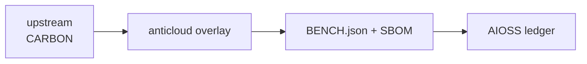

# CARBON (Anticloud overlay)
  
**Upstream:** https://github.com/carbon-design-system/carbon @ `2382eb906571231dbb928004e6de19c3bc1177a2`
**Category:** CARBON_CAPTURE
## Benchmarks (measured, with provenance)
Figures below come ONLY from `BENCH.json` (run stamp inside that file).
```json
BENCH.json missing
```
Anything not listed here is NOT YET MEASURED for this project.
## Architecture

## Contents
- `UPSTREAM_CLONE/` (untouched upstream source)
- `anticloud/` (12 improvement files)
- `BENCH.json`, `sbom.cdx.json`
## Provenance
- Upstream SHA: `2382eb906571231dbb928004e6de19c3bc1177a2`
- Tree SHA3-256: `cfc21dac36da8d409fa8b53cdfcce04f16c428f3eaf3006cf58e6455673fa88d`
## Contact
Anticloud FZ LLE — lois@0-1.gg — 0-1.gg
License: Apache-2.0 (see `anticloud/03_licence_verdict.md`).
